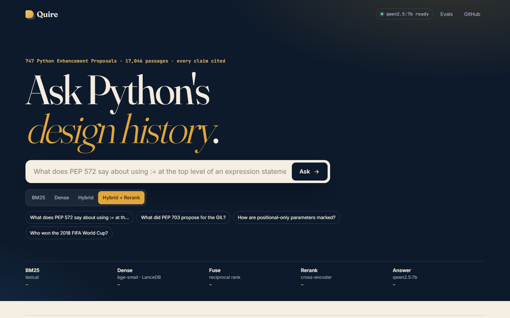
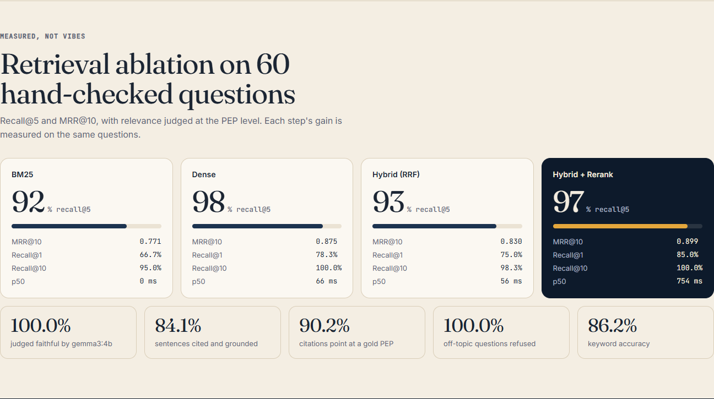
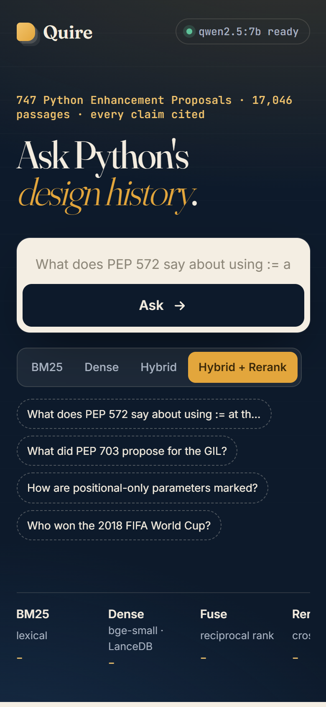

<div align="center">

# Quire

**Cited answers from the Python Enhancement Proposals.**
Hybrid retrieval (BM25 + dense + cross-encoder rerank) over all 747 PEPs, a local LLM that cites every claim or refuses, and an eval harness that measures each piece.

[](https://github.com/alok-kul5/quire/actions/workflows/ci.yml)


</div>

## Results

Measured on 70 hand-checked questions: 60 with gold PEPs checked against the source text, and 10 deliberately off-topic. Full per-question output is in [`evals/results/`](evals/results/).

### Retrieval ablation

Relevance is judged at the PEP level. Each row runs on the same 60 answerable questions.

| Retriever | Recall@1 | Recall@3 | Recall@5 | Recall@10 | MRR@10 | p50 latency (CPU) |
|---|---|---|---|---|---|---|
| BM25 | 66.7% | 83.3% | 91.7% | 95.0% | 0.771 | 0.4 ms |
| Dense (bge-small) | 78.3% | 95.0% | **98.3%** | **100.0%** | 0.875 | 66 ms |
| Hybrid (RRF) | 75.0% | 88.3% | 93.3% | 98.3% | 0.830 | 56 ms |
| **Hybrid + cross-encoder rerank** | **85.0%** | 93.3% | 96.7% | **100.0%** | **0.899** | 754 ms |

What the table shows:
- **Reranking is the step that pays.** It lifts Recall@1 from 75% to 85% over plain fusion and gives the best MRR. That matters most here, because the LLM reads the top passages first.
- **Plain RRF fusion did worse than dense alone** on this corpus. BM25's lexical misses pull good dense hits down the fused list. The cross-encoder recovers them, which is why the shipped pipeline is hybrid plus rerank, not hybrid alone.
- Dense retrieval has the best Recall@5, so a dense-only system would also be a reasonable cheaper choice. The rerank costs about 0.7 s on CPU.

### Answers and faithfulness

`qwen2.5:7b` answers from the top 6 reranked passages, and `gemma3:4b` (a different model family) judges the answers.

| Metric | Value |
|---|---|
| Answers with inline citations | **100%** |
| Citation precision (cited passage is from a gold PEP) | 90.2% |
| Heuristic faithfulness (sentence cited *and* its content words found in the cited passage) | 84.1% |
| LLM-judge faithful (score ≥ 4 of 5) | 100% (mean 4.55; 2 judge replies failed to parse and are excluded) |
| Keyword accuracy (expected term appears in the answer) | 86.2% |
| Off-topic questions refused | **100%** (10/10) |
| False refusals on answerable questions | 3.3% (2/60) |

The two faithfulness numbers disagree on purpose. A 4B judge is lenient and passes every answer. The deterministic heuristic is stricter: it flags 16% of sentences, usually because a sentence paraphrases the source in different words or carries no citation of its own. I'd rely on the heuristic as the floor and the judge as the ceiling.

Eight of the ten off-topic questions are refused before the LLM runs, because no passage clears the reranker's score floor. The model itself declines the other two. The floor (-2.5) was set from this same eval set, so treat the refusal number as optimistic.

| Hero | Evals panel | Mobile |
|---|---|---|
|  |  |  |

## How it works

```mermaid
flowchart LR
    subgraph Ingest["Ingest (offline)"]
        A[python/peps<br/>747 PEPs] --> B[Header + section parser<br/>reST cleanup]
        B --> C[Section-bounded chunks<br/>~220 words, 40 overlap<br/>+ context header]
    end
    C --> D[(bm25s index)]
    C --> E[bge-small-en-v1.5] --> F[(LanceDB<br/>384-d vectors)]

    subgraph Query["Query (online)"]
        Q[Question] --> G[BM25 top 40]
        Q --> H[Dense top 40]
        G --> I[Reciprocal rank fusion]
        H --> I
        I --> J[Cross-encoder rerank<br/>ms-marco-MiniLM-L-6]
        J --> K{best score<br/>above floor?}
        K -- no --> R[Refuse]
        K -- yes --> L[qwen2.5:7b via Ollama<br/>numbered passages]
        L --> M[Answer with inline citations<br/>invalid cites stripped]
    end
    D -.-> G
    F -.-> H

    subgraph Eval["Eval harness"]
        N[70 hand-checked questions<br/>60 answerable + 10 off-topic] --> O[Recall@k · MRR<br/>per retriever]
        N --> P[Faithfulness<br/>heuristic + gemma3:4b judge]
        N --> S[Refusal & citation precision]
    end
```

**Ingestion.** Each PEP's RFC-822 header gives the number, title, status, type and date. The body is split on reST section underlines, so a chunk never spans two sections. Inline markup (`:pep:`, `:func:`, literals, hyperlinks) is cleaned so BM25 sees real words. Paragraphs are packed into windows of about 220 words with a 40-word overlap. Each chunk is indexed with a context header (`PEP 572 - Assignment Expressions > Rationale`), so a passage that never names its PEP can still be found. Each chunk links to its exact section on peps.python.org.

**Retrieval.** BM25 (`bm25s`) and dense search (`bge-small-en-v1.5` in an embedded LanceDB table, no server) each return 40 candidates. Reciprocal rank fusion merges them, and a MiniLM cross-encoder re-scores the fused pool. Everything runs on CPU.

**Answering.** The top 6 passages are numbered and sent to `qwen2.5:7b` through Ollama, with instructions to cite each sentence and to reply `INSUFFICIENT_CONTEXT` when the passages don't support an answer. There are two refusal paths: a calibrated floor on the reranker score (off-topic questions never reach the LLM), and the model's own refusal. Citations to passages that don't exist are stripped.

**Evaluation.** There are 70 questions. 60 have gold PEPs that I checked by hand against the source text, and 10 are deliberately off-topic. The harness reports:
- **Retrieval:** Recall@1/3/5/10 and MRR@10 for each retriever (PEP-level relevance), plus latency.
- **Faithfulness:** a deterministic heuristic (is each sentence cited, and are most of its content words in the cited passages?) plus an LLM judge from a *different* model family (`gemma3:4b`) scoring 1-5.
- **Behaviour:** citation precision (does each cited passage come from a gold PEP?), keyword accuracy, refusal rate on off-topic questions and false-refusal rate on real ones.

## Run it

Needs Python 3.11 and [Ollama](https://ollama.com). No Docker, no API keys.

```bash
git clone https://github.com/alok-kul5/quire && cd quire
python -m venv .venv && . .venv/bin/activate        # Windows: .venv\Scripts\activate
pip install -r requirements.txt
ollama pull qwen2.5:7b && ollama pull gemma3:4b

git clone --depth 1 https://github.com/python/peps data/raw/peps
python -m quire.index                                # ~17k chunks, a few minutes on CPU
uvicorn quire.api:app --port 8000                    # open http://localhost:8000
```

Reproduce the numbers:

```bash
python -m quire.evaluate retrieval     # ablation table
python -m quire.evaluate generation    # answers + faithfulness + refusals
python -m quire.evaluate report        # writes evals/results/REPORT.md
```

### API

| Endpoint | Body | Returns |
|---|---|---|
| `POST /api/ask` | `{"question": "...", "mode": "rerank", "k": 6}` | answer, cited passage numbers, sources with per-stage ranks, timings |
| `POST /api/search` | `{"query": "...", "mode": "hybrid", "k": 10}` | ranked passages only |
| `GET /api/health` | | index size, models, whether Ollama is up |
| `GET /api/evals` | | latest eval summaries (the UI reads this) |

`mode` is one of `bm25`, `dense`, `hybrid` or `rerank`, so you can compare retrievers live in the UI.

## Tests

`pytest` covers chunking, reST cleanup, RRF, citation parsing, refusal paths, metrics, the API and the eval plumbing. The LLM, embedder and reranker are swapped for fakes, so CI runs in seconds without models.

## Project layout

```
quire/
  ingest.py     reST parsing and section-aware chunking
  index.py      bm25s + LanceDB build
  retrieve.py   BM25, dense, RRF, cross-encoder rerank
  answer.py     prompt, citation parsing, refusal guard
  llm.py        Ollama client + fake for tests
  metrics.py    recall/MRR, heuristic faithfulness, judge parsing
  evaluate.py   eval harness and report
  api.py        FastAPI service
web/            the UI (vanilla HTML/CSS/JS)
evals/          questions.jsonl and results/
tests/
```

## Limitations

- Relevance is judged at the PEP level, not the passage level, so a retriever gets credit for any chunk from the right PEP.
- The judge is a 4B model. It is a different family from the answerer, but it is still a small model, which is why the deterministic heuristic is reported next to it.
- The question set is small (70), so differences of a few points between retrievers are within noise.
- The refusal floor was calibrated on this same question set, so the 100% off-topic refusal rate is optimistic.
- LLM latency (p50 about 60 s in the eval) was measured on an 8 GB laptop GPU shared with other model jobs, so it reflects queueing more than the model itself.

## License

Code: MIT. Corpus: the PEPs are placed in the public domain or under CC0-1.0 by their authors ([python/peps](https://github.com/python/peps)).

---

<sub>One of seventeen projects by [Alok Kulkarni](https://alok.is-a.dev): [Hearth](https://github.com/alok-kul5/hearth-iot) home sensors · [Headway](https://github.com/alok-kul5/headway-transit) transit data · [Vigil](https://github.com/alok-kul5/vigil-soc) security triage · [Loupe](https://github.com/alok-kul5/loupe-vision) defect inspection · [Kharcha](https://github.com/alok-kul5/kharcha-finance) personal finance · [Stockroom](https://github.com/alok-kul5/stockroom-inventory) inventory · [Quietwire](https://github.com/alok-kul5/quietwire-villa) smart home design · [Canopy](https://alok.is-a.dev/canopy/) coffee storefront · [Picket](https://github.com/alok-kul5/picket) detection rules · [Warden](https://github.com/alok-kul5/warden-iac) cloud IaC scanning · [Marquee](https://github.com/alok-kul5/marquee-recs) recommendations · [Kestrel](https://github.com/alok-kul5/kestrel) fraud detection · [Almanac](https://github.com/alok-kul5/almanac-forecast) demand forecasting · [Quarry](https://github.com/alok-kul5/quarry-sql) data questions in plain English · **Quire** cited answers about Python · [Transit](https://github.com/alok-kul5/transit-mumbai) Mumbai trains · [Pulse](https://github.com/alok-kul5/pulse-habits) habit tracker.</sub>
