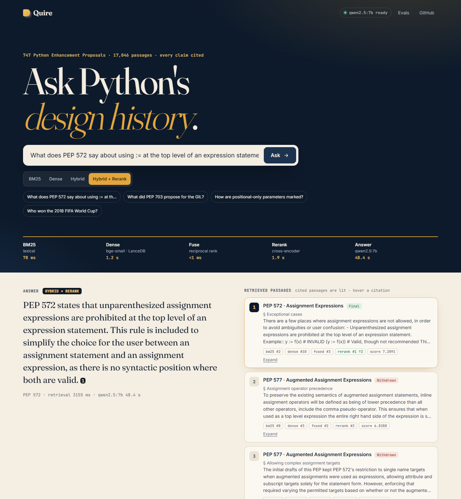

<div align="center">

# Quire

**Cited answers from the Python Enhancement Proposals.**
Hybrid retrieval (BM25 + dense + cross-encoder rerank) over all 748 PEPs, a local LLM that cites every claim or refuses, and an eval harness that measures each piece.

[](https://github.com/alok-kul5/quire/actions/workflows/ci.yml)




</div>

## Results

<!-- RESULTS -->

## How it works

```mermaid
flowchart LR
    subgraph Ingest["Ingest (offline)"]
        A[python/peps<br/>748 .rst files] --> B[Header + section parser<br/>reST cleanup]
        B --> C[Section-bounded chunks<br/>~220 words, 40 overlap<br/>+ context header]
    end
    C --> D[(bm25s index)]
    C --> E[bge-small-en-v1.5] --> F[(LanceDB<br/>384-d vectors)]

    subgraph Query["Query (online)"]
        Q[Question] --> G[BM25 top 40]
        Q --> H[Dense top 40]
        G --> I[Reciprocal rank fusion]
        H --> I
        I --> J[Cross-encoder rerank<br/>ms-marco-MiniLM-L-6]
        J --> K{best score<br/>above floor?}
        K -- no --> R[Refuse]
        K -- yes --> L[qwen3:4b via Ollama<br/>numbered passages]
        L --> M[Answer with inline citations<br/>invalid cites stripped]
    end
    D -.-> G
    F -.-> H

    subgraph Eval["Eval harness"]
        N[70 hand-checked questions<br/>60 answerable + 10 off-topic] --> O[Recall@k · MRR<br/>per retriever]
        N --> P[Faithfulness<br/>heuristic + gemma3:4b judge]
        N --> S[Refusal & citation precision]
    end
```

**Ingestion.** Each PEP's RFC-822 header gives the number, title, status, type and date. The body is split on reST section underlines, so a chunk never spans two sections. Inline markup (`:pep:`, `:func:`, literals, hyperlinks) is cleaned so BM25 sees real words. Paragraphs are packed into windows of about 220 words with a 40-word overlap. Each chunk is indexed with a context header (`PEP 572 - Assignment Expressions > Rationale`), so a passage that never names its PEP can still be found. Each chunk links to its exact section on peps.python.org.

**Retrieval.** BM25 (`bm25s`) and dense search (`bge-small-en-v1.5` in an embedded LanceDB table, no server) each return 40 candidates. Reciprocal rank fusion merges them, and a MiniLM cross-encoder re-scores the fused pool. Everything runs on CPU.

**Answering.** The top 6 passages are numbered and sent to `qwen3:4b` through Ollama, with instructions to cite each sentence and to reply `INSUFFICIENT_CONTEXT` when the passages don't support an answer. There are two refusal paths: a calibrated floor on the reranker score (off-topic questions never reach the LLM), and the model's own refusal. Citations to passages that don't exist are stripped.

**Evaluation.** There are 70 questions. 60 have gold PEPs that I checked by hand against the source text, and 10 are deliberately off-topic. The harness reports:
- **Retrieval:** Recall@1/3/5/10 and MRR@10 for each retriever (PEP-level relevance), plus latency.
- **Faithfulness:** a deterministic heuristic (is each sentence cited, and are most of its content words in the cited passages?) plus an LLM judge from a *different* model family (`gemma3:4b`) scoring 1-5.
- **Behaviour:** citation precision (does each cited passage come from a gold PEP?), keyword accuracy, refusal rate on off-topic questions and false-refusal rate on real ones.

## Run it

Needs Python 3.11 and [Ollama](https://ollama.com). No Docker, no API keys.

```bash
git clone https://github.com/alok-kul5/quire && cd quire
python -m venv .venv && . .venv/bin/activate        # Windows: .venv\Scripts\activate
pip install -r requirements.txt
ollama pull qwen3:4b && ollama pull gemma3:4b

git clone --depth 1 https://github.com/python/peps data/raw/peps
python -m quire.index                                # ~17k chunks, a few minutes on CPU
uvicorn quire.api:app --port 8000                    # open http://localhost:8000
```

Reproduce the numbers:

```bash
python -m quire.evaluate retrieval     # ablation table
python -m quire.evaluate generation    # answers + faithfulness + refusals
python -m quire.evaluate report        # writes evals/results/REPORT.md
```

### API

| Endpoint | Body | Returns |
|---|---|---|
| `POST /api/ask` | `{"question": "...", "mode": "rerank", "k": 6}` | answer, cited passage numbers, sources with per-stage ranks, timings |
| `POST /api/search` | `{"query": "...", "mode": "hybrid", "k": 10}` | ranked passages only |
| `GET /api/health` | | index size, models, whether Ollama is up |
| `GET /api/evals` | | latest eval summaries (the UI reads this) |

`mode` is one of `bm25`, `dense`, `hybrid` or `rerank`, so you can compare retrievers live in the UI.

## Tests

`pytest` covers chunking, reST cleanup, RRF, citation parsing, refusal paths, metrics, the API and the eval plumbing. The LLM, embedder and reranker are swapped for fakes, so CI runs in seconds without models.

## Project layout

```
quire/
  ingest.py     reST parsing and section-aware chunking
  index.py      bm25s + LanceDB build
  retrieve.py   BM25, dense, RRF, cross-encoder rerank
  answer.py     prompt, citation parsing, refusal guard
  llm.py        Ollama client + fake for tests
  metrics.py    recall/MRR, heuristic faithfulness, judge parsing
  evaluate.py   eval harness and report
  api.py        FastAPI service
web/            the UI (vanilla HTML/CSS/JS)
evals/          questions.jsonl and results/
tests/
```

## Limitations

- Relevance is judged at the PEP level, not the passage level, so a retriever gets credit for any chunk from the right PEP.
- The judge is a 4B model. It is a different family from the answerer, but it is still a small model, which is why the deterministic heuristic is reported next to it.
- The question set is small (70), so differences of a few points between retrievers are within noise.

## License

Code: MIT. Corpus: the PEPs are placed in the public domain or under CC0-1.0 by their authors ([python/peps](https://github.com/python/peps)).
